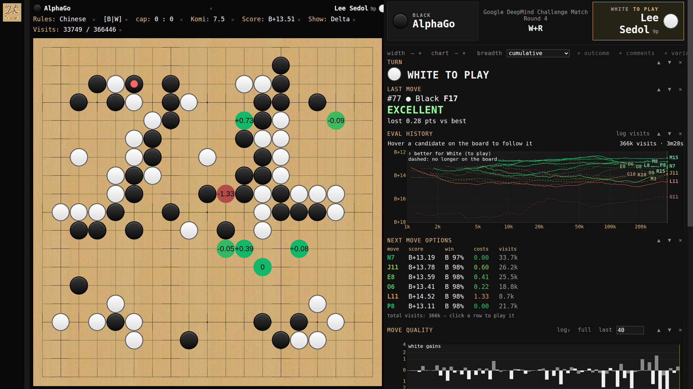
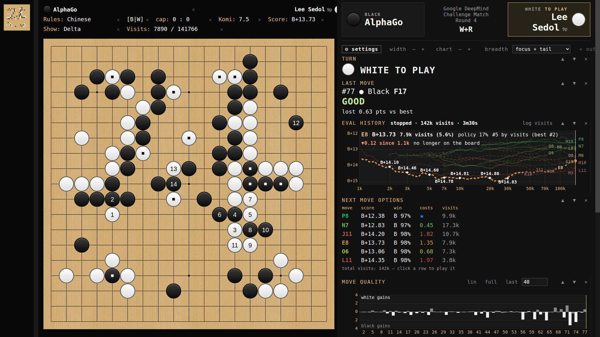
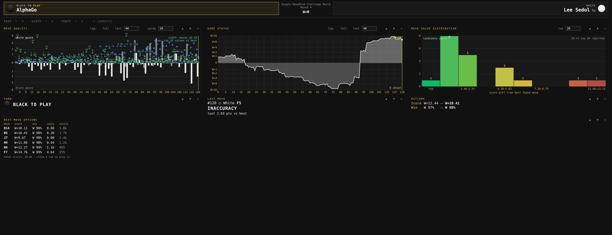

# ogatak-clear

A Go game-review and position-study interface for [KataGo](https://github.com/lightvector/KataGo), built on [rooklift/ogatak](https://github.com/rooklift/ogatak).

`ogatak-clear` builds on Ogatak's fast KataGo GUI and SGF editor with a set of interactive visual tools for reading positions clearly: side-labeled evaluations, point-cost candidate markers, live what-if stone moving with score-swing comparison, continuation narrowness analysis, search-convergence curves, separated whole-game charts, and a dockable workspace where every panel resizes freely.



_Lee Sedol-AlphaGo Game 4, just before move 78 (142k visits). On the board: the best move (`P8`, blue star), the five next-best moves labelled with the exact points each loses against it, and the move Lee played (`L11`). On the right: Eval History plots each candidate's score over the course of the search._

---

## What you can do with ogatak-clear

### 1. Test "what if this stone were here instead?" directly on the board

During review, many useful questions are about stones already on the board: *"what if that stone from ten moves ago were one line higher?"* or *"how does this fight shift if that ladder breaker sits over here?"*

* **Ctrl+drag any stone (Cmd+drag on macOS)** onto an empty intersection and release. Consecutive drags fold into a single sibling variation right beside the current position, leaving the real game untouched as the main line.
* **Read the game impact immediately:** a live **What-If banner** appears above the board showing whether the moved stone(s) help Black or White (`+2.1 pts better for Black`, paired with a centered W/B shift bar and before/after scores), and whether the **next best move changed** (`Best move: R14 -> Q14`, along with how many points the original best move now loses).
* **Keep the change easy to trace:** dashed gold rings mark each stone's original intersection, gold arrows point to the relocated stones, the original best move is marked `orig ★` in the options table, and one click on **`↩ Original`** returns straight to the game position. Dragging stones back to their original spots removes the temporary variation automatically.

### 2. Read candidates, scores, and turns at a glance

* **Point-loss labels on every candidate:** one move carries the blue star (`★`), and every other candidate shows the exact points it loses compared to the best move (`-0.67`, or `67` in basis-point display) along a continuous color gradient. The loss shown before a move matches the Move Quality verdict after it is played, even when a side is far behind.
* **Turn-colored candidate outlines:** candidate borders and the star outline match the side to play (black outlines for Black's turn, white outlines for White's turn), while the interior color shows move quality.
* **Explicit perspective on every number:** scores and winrates always state who is ahead (`B+2.30`, `W 61%`). Move verdicts state the points lost and where the best move was (`MISTAKE - lost 3.20 pts vs best - best was D4 (5 lines away)`).
* **Steady candidate selection:** a 50-visit stability gate keeps early low-visit fluctuations from rapidly swapping the best-move star. Switch between showing every move within a point cutoff (`<= 0.30` ... `<= 8.00`) or a fixed `Best + N`, while always keeping the actual game move and explored variations visible.

### 3. Distinguish forcing lines from open fights (`Variation Space`)

Two candidate moves can share the same score while leading to very different positions: one may force a narrow reply, while another leaves your opponent many equally good choices.

* **Measure opponent narrowness automatically:** `Next Move Options` and **Variation Space** check already-analyzed branches in your variation tree first, then run quiet background probes after each candidate move to measure:
  * **Opponent gap (`opp gap`):** how many points the opponent loses if they miss their best reply - larger values indicate sharper, more forcing lines.
  * **Effective replies (`opp width` / `N_eff`):** how many genuinely competitive replies exist (`1.0` for a single forced reply, higher for broad positions), drawn with a relative bar across the current candidates.
  * **Policy loss (`π loss`):** the expected point loss across the opponent's high-prior replies, highlighting sharp moves where natural-looking answers fall short.
* **Walk and play forcing corridors:** hover any continuation sequence to preview numbered stones on the board, click a sequence to play it into the variation tree, click **`trace`** to extend a 5-ply corridor, or click **`probe deeper`** for higher-visit confirmation.

### 4. Follow KataGo's search as it deepens (`Eval History`)


_Hovering a move on the board or in the chart highlights its search trajectory and previews its continuation on the board._

* **Track convergence over visits:** **Eval History** plots each candidate's score against total search visits (logarithmic or linear), making it clear whether an evaluation has settled or is still shifting as the search goes deeper.
* **Inspect moves that left the board:** candidates that previously appeared on the board remain visible as dashed curves after dropping out of the top set. Hover or click any line label to pin it and preview its continuation on the board alongside its visits, share of search, policy prior, rank history, and score change.



### 5. Review whole-game quality, score lead, and choice breadth



* **Move Quality:** one clickable bar per move showing pure point loss (White gains upward, Black gains downward). Toggle between **linear** and **log₂** vertical scales so small endgame inaccuracies stay readable beside large swings, and choose full-game or sliding-window framing (e.g., last 40 moves).
* **Game Status:** a dedicated clickable chart for the running score lead across the game, using the same White-up / Black-down orientation and linear / log₂ toggle.
* **Choice Breadth & Candidate Profile:** track how many near-best moves existed at every turn (`Width`, saved in the SGF) and inspect the distribution of candidate costs at the current move across five paired views (*focus + tail*, *fixed bands*, *cumulative*, *rank landscape*, and *decision summary*).

### 6. Keep deeper reading as you explore (`Explored` & `Inherited` values)

* **Immediate evaluations when stepping forward:** playing a move KataGo already searched initializes the child position with that evaluation (`inherited`) until the child's own search overtakes it.
* **Deeper branch reading propagates upward:** exploring a variation and stepping back updates the parent move's displayed value from your deeper search (optionally drawn as a rounded square and marked `explored`).
* **Deepest valid analysis is preserved:** revisiting a position keeps its highest-visit analysis for the same rules, komi, board state, and engine setup.

### 7. Arrange the workspace to match your study flow

* **Unified dockable layout:** the Go board, Settings, Variation Tree, comments, options table, and charts are all dockable panels. Drag any splitter to resize the board or analysis panels smoothly in both axes, or drag tabs to split, stack, float, or maximize panels. Layouts save automatically and fit the window without outer scrollbars.
* **One-click presets:** switch between **Review** (board, Eval History, Next Move Options, and Variation Tree), **Explore** (adds Variation Space side by side), and **Minimal** (larger board with options and tree), or open additional panels from **`+ panels`**.
* **Live, searchable Settings (`Ctrl+,` or `⚙ settings`):** opens beside the live Go board so changes take effect immediately while you watch, including a live time estimate showing how long your visit limit takes at your current engine speed.


* **Full game-review essentials from Ogatak:** SGF editing and multi-format import (SGF / NGF / GIB / UGI), copy/paste SGF (`Ctrl+Shift+C` / `Ctrl+Shift+V`), optional move numbers on stones, board-scoped mouse wheel stepping, high-contrast typography on a unified font scale, whole-UI zoom (`Ctrl+=`, `Ctrl+-`, `Ctrl+Shift+0`), and fullscreen (`Alt+Enter`).

---

## Setup & technical notes

* **Requirements:** Node.js, [KataGo](https://github.com/lightvector/KataGo), and a KataGo neural-network weights file.
* **Install & run from source:**
  ```bash
  cd src && npm install --no-save electron
  cd .. && src/node_modules/.bin/electron src
  ```
  On Linux systems that restrict unprivileged user namespaces (such as Ubuntu 24.04+), enable Electron's sandbox once after installing:
  ```bash
  sudo chown root:root src/node_modules/electron/dist/chrome-sandbox && sudo chmod 4755 src/node_modules/electron/dist/chrome-sandbox
  ```
  Point `ogatak-clear` at your KataGo binary and weights under `Setup -> Locate KataGo...` and `Setup -> Choose network...`. If you previously used upstream Ogatak, your existing `config.json` is copied automatically on first launch.
* **Tests:** run syntax checks and unit tests with plain Node (no Electron needed):
  ```bash
  for f in src/*.js src/modules/*.js; do node --check "$f" || exit 1; done
  for t in src/modules/*.test.js; do node "$t" || exit 1; done
  ```
* **Performance notes:** per-move ownership (`Analysis` menu) is the heaviest option; adjust the report interval (`Setup`, default `0.1` s) to trade update frequency for lower overhead. Candidate display filters affect display only and never restrict KataGo's search.
* **Design docs:** full specifications and rationale live in [PRODUCT.md](PRODUCT.md) and [PRODUCT-workspace.md](PRODUCT-workspace.md).
* **Credits & license:** built on [rooklift/ogatak](https://github.com/rooklift/ogatak), powered by [KataGo](https://github.com/lightvector/KataGo), dockable layout via [dockview-core](https://dockview.dev/) (MIT), stone and board graphics modified from [Sabaki](https://github.com/SabakiHQ/Sabaki), and shaped by ideas from Lizzie, KaTrain, CGoban, and LizGoban. Licensed under **GNU AGPL v3.0**.
