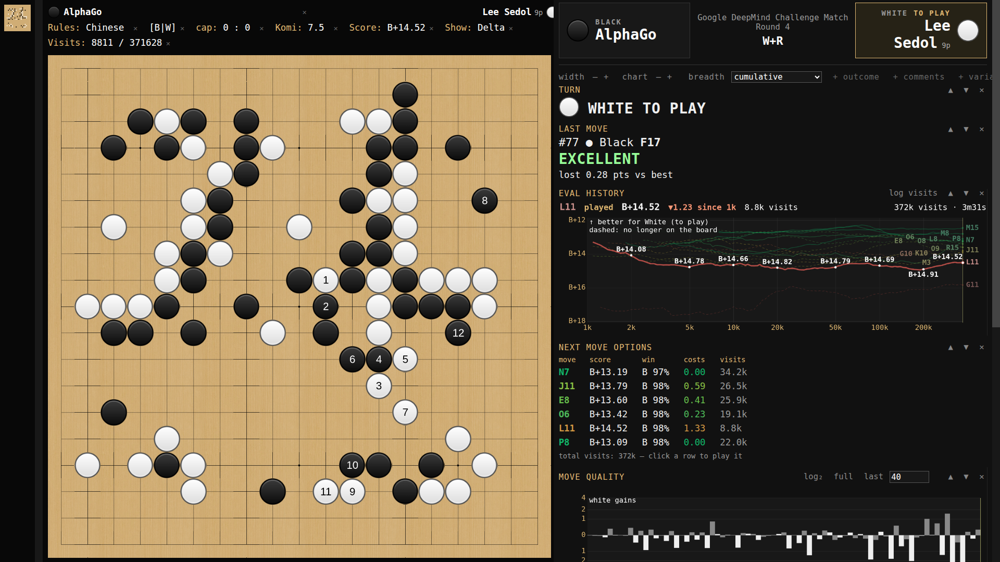
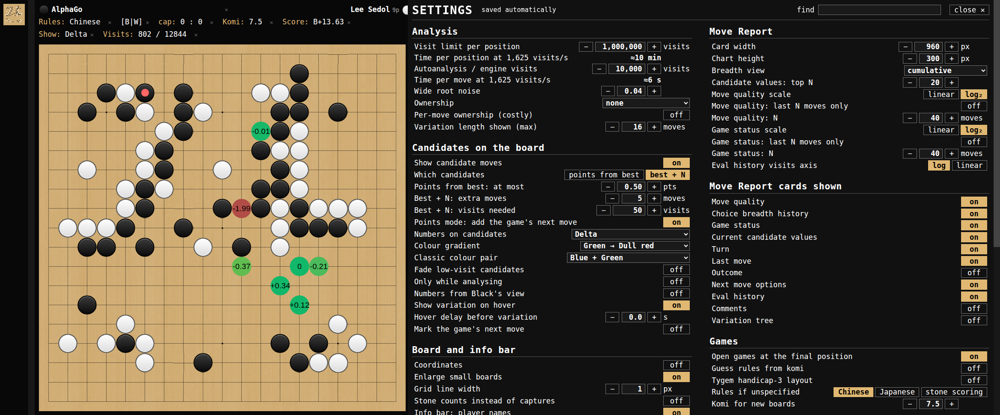

# ogatak-clear

**A Go analysis workspace that actually answers the questions you have while reviewing a game.**

Most KataGo GUIs hand you raw numbers — bare `+3.2` scores you have to decode against whose turn it is, visit counts instead of point costs, flickering candidate circles, and one cramped graph that muddles whether a move was bad with who happened to be ahead.

`ogatak-clear` (built on [rooklift/ogatak](https://github.com/rooklift/ogatak)) turns KataGo into a clear, interactive study studio. Every number says who it favors, every visual answers one clear question, and you can test ideas directly on the board — including dragging existing stones to new spots to see how the position and best move change.


_Lee Sedol–AlphaGo Game 4, just before move 78 (142k visits). On the board: the best move (`P8`, blue star), the five next-best moves labelled with the exact points each loses against it, and the move Lee played (`L11`). On the right: Eval History plots every candidate's score over the course of the search._

---

## What you can do with ogatak-clear

### 1. Ask "what if this stone were over here instead?" — and see the answer immediately

In real Go study, half your questions aren't *"what should I play next?"* — they're *"what if that stone from ten moves ago were one line higher?"* or *"does my whole fight change if that ladder breaker sits here instead?"*

* **Ctrl+drag any stone (Cmd+drag on macOS)** straight to an empty intersection and let go. Drag as many stones as you like; consecutive drags fold cleanly into **one** variation right beside the original position, leaving your real game untouched as the main line.
* **See the game impact at a glance:** a live **What-If banner** appears right above the board telling you in plain terms whether the moved stone(s) make the position better for Black or White (`+2.1 pts better for Black`, with a centered W/B shift bar and before/after scores), plus whether the **next best move changed** (`Best move: R14 → Q14`, and how many points the old best move now loses).
* **Never lose track of what you moved:** dashed gold rings mark where the stones came from, gold arrows point to where you moved them, the old best move is tagged `orig ★` in the options list, and one click on **`↩ Original`** jumps straight back to the real game. Dragging a stone back to its original spot even cleans up the variation automatically.

### 2. Read the board in one glance — zero sign math, zero guesswork

* **Know what every move actually costs:** one move gets the blue star (`★`), and every other candidate shows the exact points it loses relative to the best move (`-0.67`, or `67` in basis-point display) on a smooth color gradient. Being behind in the game never makes the best move look bad, and the cost you see before a move matches the verdict after it is played.
* **Always know whose turn it is:** candidate outlines and the star border match the player to move — crisp black outlines when Black is to play, crisp white outlines when White is to play — while the interior color shows move quality.
* **No more bare signed numbers:** scores and winrates always name the side ahead (`B+2.30`, `W 61%`). Move verdicts tell you plainly how many points were lost and where the best move was (`MISTAKE — lost 3.20 pts vs best — best was D4 (5 lines away)`).
* **Calm, steady board markers:** a 50-visit stability gate stops noisy first-visit flukes from stealing the star and flickering across the board. Choose between showing every move within a point cutoff (`≤ 0.30` … `≤ 8.00`) or a fixed `Best + N`, while always keeping the actual game move and explored variations visible.

### 3. Tell forcing lines apart from open fights (`Variation Space`)

Two moves can both score `B+1.5`, yet one forces a single sharp reply while the other hands your opponent six good ways to complicate the board.

* **See how narrow or wide each choice forces your opponent to be:** `Next Move Options` and **Variation Space** run quiet background probes after each candidate move (reusing anything already in your variation tree first) and measure opponent narrowness without arbitrary cutoffs:
  * **Opponent gap (`opp gap`):** how many points your opponent loses if they miss their best reply — bigger means sharper and more forcing.
  * **Effective replies (`opp width` / `N_eff`):** how many genuinely competitive replies your opponent has (`1.0` = forced, higher = broad and flexible), shown with a relative bar across your current options.
  * **Policy trap (`π loss`):** how costly your opponent's intuitive high-prior replies are — great for spotting sharp tesuji where natural-looking answers fail.
* **Preview and walk forcing corridors:** hover any continuation sequence to preview numbered stones directly on the board, click a sequence to play it straight into the variation tree, click **`trace`** to walk a 5-ply forcing corridor, or click **`probe deeper`** when you want higher-visit confirmation.

### 4. Watch KataGo think — and catch moves it changes its mind about (`Eval History`)



_Hovering a move on the board or in the chart highlights its search trajectory and previews its continuation on the board._

* **See whether a position has settled or is still swinging:** **Eval History** plots every candidate's score against search visits (log or linear) so you immediately know whether KataGo was sure from the start or just discovered a deeper tactic at 50k visits.
* **Inspect moves KataGo abandoned:** any candidate that ever made it onto the board keeps its curve as a dashed line even after dropping off the board. Hover or click any label to pin it and preview its continuation right on the board, along with its visits, search share, policy prior, rank history, and score drift.


### 5. Separate "did I play well?" from "who was winning?" — and see where positions got sharp


* **Move Quality:** one bar per move showing pure point loss (White gains up, Black gains down). Toggle between **linear** and **log₂** scales so subtle 0.5-point endgame slips stay legible right next to a 15-point blunder, and switch between the whole game or a sliding window (e.g., last 40 moves). Click any bar to jump straight to that move.
* **Game Status:** a separate clickable chart dedicated to who was ahead across the game, matching the same White-up / Black-down orientation and linear / log₂ toggle.
* **Choice Breadth & Candidate Profile:** track how many good moves existed at every turn (`Width` — saved right inside the SGF) and inspect the full spread of candidate costs at the current move across five paired views (*focus + tail*, *fixed bands*, *cumulative*, *rank landscape*, and *decision summary*).

### 6. Explore deeply without losing work (`Explored` & `Inherited` values)

* **Instant feedback as you step forward:** playing a move KataGo already searched starts the child position from that evaluation immediately (`inherited`) instead of flashing blank until a new search warms up.
* **Your deeper reading flows back up:** explore a tricky variation deeper, step back to the branch point, and the parent position keeps your deeper evaluation (optionally marked as a rounded square and tagged `explored`).
* **Deepest search always wins:** stepping away and coming back never wipes out a deep analysis with a quick early snapshot.

### 7. Arrange the whole studio to fit how you study

* **Every panel — including the Go board and Settings — is dockable and resizable:** drag any divider to make the Go board huge or give more room to charts; drag tabs to split, stack, float, or maximize any panel. Everything fits your window with zero outer scrollbars, and your layout saves automatically.
* **Switch workflows in one click:** jump between **Review** (board + Eval History + Next Move Options + Variation Tree), **Explore** (adds Variation Space side by side), and **Minimal** (bigger board with compact options and tree), or open any extra panel from **`+ panels`**.
* **One live, searchable Settings panel (`Ctrl+,` or `⚙ settings`):** docks right beside the live Go board so you see every change take effect immediately — including a live time estimate showing how long your visit cap takes on your machine right now.



* **Built for comfortable long sessions:** pure high-contrast text (never dim gray), one unified font scale plus full-UI zoom (`Ctrl+=`, `Ctrl+-`, `Ctrl+Shift+0`), fullscreen (`Alt+Enter`), mouse wheel safely scoped to the board only, full SGF / NGF / GIB / UGI support, copy/paste SGF (`Ctrl+Shift+C` / `Ctrl+Shift+V`), and optional move numbers on stones.

---

## Setup & technical notes

* **Requirements:** Node.js, [KataGo](https://github.com/lightvector/KataGo), and a KataGo neural-network weights file.
* **Install & run from source:**
  ```bash
  cd src && npm install --no-save electron
  cd .. && src/node_modules/.bin/electron src
  ```
  On Linux systems that restrict unprivileged user namespaces (such as Ubuntu 24.04+), enable Electron's sandbox once after installing:
  ```bash
  sudo chown root:root src/node_modules/electron/dist/chrome-sandbox && sudo chmod 4755 src/node_modules/electron/dist/chrome-sandbox
  ```
  Point `ogatak-clear` at your KataGo binary and weights under `Setup → Locate KataGo...` and `Setup → Choose network...` (if you previously used upstream Ogatak, your existing `config.json` is copied over automatically on first launch).
* **Tests:** run the syntax checks and unit tests with plain Node (no Electron needed):
  ```bash
  for f in src/*.js src/modules/*.js; do node --check "$f" || exit 1; done
  for t in src/modules/*.test.js; do node "$t" || exit 1; done
  ```
* **Performance notes:** per-move ownership (`Analysis` menu) is the heaviest option — disable it if the UI feels slow; adjust the report interval (`Setup`, default `0.1` s) to trade update smoothness for lower overhead. Candidate display filters never restrict KataGo's actual search.
* **Design docs:** full specifications and rationale live in [PRODUCT.md](PRODUCT.md) and [PRODUCT-workspace.md](PRODUCT-workspace.md).
* **Credits & license:** forked from [rooklift/ogatak](https://github.com/rooklift/ogatak), powered by [KataGo](https://github.com/lightvector/KataGo), dockable layout via [dockview-core](https://dockview.dev/) (MIT), stone/board graphics modified from [Sabaki](https://github.com/SabakiHQ/Sabaki), and inspired by Lizzie, KaTrain, CGoban, and LizGoban. Licensed under **GNU AGPL v3.0**.
